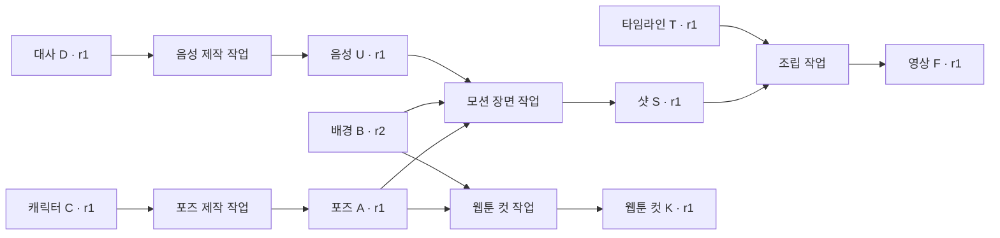

# 제작 확장팩의 공통 자산 ID·파생 그래프·재사용 계약

2026-10-21. 사용자가 지적한 자산 순환을 [모션 제작 확장안](2026-10-21-motion-production-extension.md)의
**필수 수용 조건**으로 구체화한다. 새 코드 구현 기록은 아니다. 이전 도식의 ‘재사용 후보’ 화살표만으로는
모든 중간/최종 자산이 기존 공통 자원으로 돌아온다는 것을 보장하지 못했다.

## 1. 답과 설계 원칙

**새로 생성하는 모든 관리 자산도 공통 ID·판본·파생 관계를 가져야 한다.** 캐릭터·포즈·표정·분리 레이어·
배경·대사/스토리·음성·음악·리그·타임라인·샷·미리보기·최종 영상 중 보존하는 결과가 대상이다.
영상 확장팩 전용 라이브러리에만 파일을 남기는 구현은 이 제안을 충족하지 않는다.

1. 기존 자산을 고르면 그 ID·판본을 사용한다. 다른 팩에서 쓴다는 이유로 새 정체성을 만들지 않는다.
2. 새 포즈·새 녹음처럼 별도 결과물이면 새 `resourceId`를 부여하고, 수정본이면 같은 ID의 새 revision을 만든다.
3. 해당 결과를 만든 operation과 고정 입력 판본을 결속한다. 임시 로컬 경로만 결과로 반환하지 않는다.
4. 결과 후보의 등록과 품질 승인·입력 채택·세계관 정본 변경을 구별한다. 후보도 ID를 가지며 채택된 척하지 않는다.
5. 검토·선택된 결과를 다른 작업이 같은 판본으로 읽고, 그 작업의 결과도 같은 공통 계약으로 등록한다.
6. 무엇에서 만들어졌고 어디에 쓰였는지 양방향으로 조회할 수 있어야 한다. 조회 화면의 표시만으로 관계를 확정하지 않는다.

이것이 제작 확장팩의 Interface다. 로컬 렌더가 성공해도 이 결속이 없으면 통합 완료가 아니다.
일회성 디코딩 버퍼 등 내부 임시 데이터까지 개별 자산으로 만들지는 않는다. 실제 생성 후보나 선택/편집에
사용한 중간 결과를 ‘임시 파일’로 분류해 출처를 생략해서는 안 된다.

## 2. ID와 관계는 서로 다른 역할이다

| 구분 | 의미·예시 | 피할 오해 |
|---|---|---|
| `resourceId` | 논리 자산의 정체성: 포즈 A, 대사 녹음 B, 장면 C | 파일명·공급자 결과 ID·content hash와 동일하지 않음 |
| `revisionId` | 그 자산의 정확한 불변 판본 | ‘항상 최신’ 참조로 과거 제작 입력을 바꾸지 않음 |
| `contentHash` | 보존한 내용 bytes의 일치 | 같은 bytes라는 이유만으로 다른 논리 자산을 합치지 않음 |
| `operationId` | 고정 입력에서 결과를 만드는 작업 요청 | 실제 외부 서비스 실행/성공의 인증서가 아님 |
| 입력/결과 관계 | 자원 판본 → operation → 결과 판본 | `parents`에 다른 자산을 넣어 대체하지 않음 |
| 수정 관계 | 동일 `resourceId`의 옛 판본 → 새 판본(`parents`) | 캐릭터와 그 캐릭터의 포즈를 같은 자산의 수정본으로 취급하지 않음 |
| 의미/사용 관계 | 포즈가 묘사하는 캐릭터, 음성의 발화자, 장면에서 사용한 자산과 구간 | 실제 생성 입력 계보와 등장·연관 의미를 혼동하지 않음 |

현재 `resourceId`는 호출자가 넘기고 `revisionId`는 저장 코드가 계산한다. 제작 모듈이 공통 식별 규약에 따라
새 ID를 할당·등록해야 한다. 현재 엔진이 모든 생성 도구의 결과를 자동 발견·등록한다고 주장하지 않는다.
의미/사용 관계는 팩의 판본 있는 데이터와 검토 근거로 보존하고, 그래프는 그 기록을 읽는 파생 뷰로 만든다.
엔진이 대조한 입력/출력 결속과 호스트/팩이 보고한 의미 관계의 관측 수준도 표시한다.

## 3. 실제로 순환하는 예

아래 ID와 `@r1`은 설명용 표기다. 실제 revisionId는 hash이며 모든 관리 자산은 같은 공통 자원 공간에 속한다.

모션과 웹툰이 **같은 포즈 A·r1**을 사용한다. 음성 U와 타임라인 T도 각각 독립 자산이다.
컷 K를 다시 모션 작업에 쓸 때는 K·r1을 고정한 새 operation이 생긴다. 캐릭터 C·r1을 덮어쓰지 않는다.
최종 영상뿐 아니라 재사용할 포즈·레이어·음원·샷·타임라인을 각각 출력으로 남기는 것이 중요하다.

제품의 선순환은 `원본 선택 → 제작 → 새 자산 등록·관계 결속 → 검토/입력 채택 → 다음 제작`이다.
판본별 파생 계보에서는 새 작업/새 판본이 추가된다. 과거 자산의 입력을 나중 결과로 고쳐 쓰는 순환은 만들지 않는다.
동일 자산에 대한 다음 수정·다른 매체의 재사용과, 캐릭터끼리의 순환 가능한 의미 관계는 구별한다.

## 4. 관계를 남기는 단위

- 제작 설정/장면 계획·정확한 원작 발췌도 판본 있는 입력 자원으로 보존한다.
- 각 독립 결과를 만든 operation이 실제 제공한 입력 묶음과 결과 판본을 결속한다.
- 서로 입력이 다른 결과는 operation을 나눈다. 큰 작업 하나에 모든 재료/결과를 넣고
  모든 결과가 모든 입력을 사용했다고 단정하는 그래프를 만들지 않는다.
- 현재의 입력 묶음은 ‘고정 제공된 입력’의 근거다. 모델이 그중 어느 의미를 실제 반영했는지까지
  자동 증명하는 것은 아니다. 캐릭터 묘사·발화자·참조 역할은 분야 계약/실제 결과 검토로 구별한다.
- 패키지 manifest는 각 자산 ID/판본과 조립 관계를 가리킨다. 폴더 경로 문자열만 나열하지 않는다.
- 서비스 결과 ID·원본 다운로드·편집본의 관계를 보존한다. 서비스 중단 뒤 같은 결과를 찾았으면
  기존 등록/작업을 회복하고 ID나 생성 호출을 무조건 새로 만들지 않는다.

원고·추적·managed asset과 범용 Resource는 현재 독립 경로다. bridge는 원래 자산 ID·원본 범위·판본/hash를
보존한 안정적 대응을 가져야 한다. 같은 자산을 다시 가져올 때마다 새 자산으로 늘리지 않는다.
동명 ID 충돌·다른 작업 공간의 식별/공유는 별도 계약이며 이번 확인으로 해결됐다고 보고하지 않는다.

## 5. 등록·승인·입력 채택·정본 채택을 나눈다

생성 직후 결과는 **공통 ID를 가진 후보**로 등록하고 해당 작업의 결과로 결속한다. 이후 품질 검토와
사용 결정을 기록한다. 다른 작업의 입력으로 쓸 정확한 판본을 선택하되 원작의 세계관 정본 채택과 구별한다.
사용자가 기존에 허용한 범위는 재사용하고, 그 밖의 사용자 결정/위임을 호스트가 만들어내지 않는다.

현재 Resource 입력 준비는 사용자 선택 marker가 필요하다. 결과 승인만으로 다음 작업 입력에 자동 채택되지 않는다.
현재 host grant도 create-candidate/publish 범위이며 source-selection을 위임하지 않는다. 완전 자동 순환은
별도 권한 설계 없이 약속하지 않는다. 반대로 새 자산에 ID와 계보를 붙이는 일 자체를 매번 수동 후처리로 남기지 않는다.

현재 metadata는 선택된 판본을 승인 여부와 무관하게 `role: source`, 승인된 publication 결과를
`role: output`으로 보여준다. source 선택은 품질 합격을 뜻하지 않는다. 미선택·미승인 후보와
불채택 결과 전체를 제작 이력에서 ID/원인 작업으로 추적하는 조회는 추가 수용 조건이다.
raw revision read로 후보를 읽는 기능과 구별하며 결과를 자동 정본으로 올리지 않는다.

## 6. 현재 있는 연결과 추가해야 하는 연결

근거는 보조 production-ready 작업 트리(`e7516d1` + 기존 변경)를 읽은 것이다. 지정 cwd와 다르다.

| 항목 | 현재 확인한 구현 | 이번 확장에 필요한 것 |
|---|---|---|
| 결과 ID/판본 | `core/resources/revisions.js`의 Resource 후보·불변 revision | 모든 제작 모듈의 관리 결과에 등록을 의무화 |
| 입력→결과 결속 | `core/operations/requests.js`, publication의 snapshot/출력 hash/receipt | 포즈·오디오·장면 등 독립 결과별 정확한 작업 단위 |
| 출력→다음 입력 | 출력 판본을 source 선택 후 `prepareInput` 가능 | 원본 bridge와 사용 가능한 결과의 선택 흐름 연결 |
| 직접 의존 조회 | `core/projections/metadata.js`의 output `inputRefs` | 역방향 사용처 및 여러 단계를 거친 선행/후행 조회 |
| 기존 그래프 화면 | `core/view/graph-view.js`는 원고 노드↔대상 및 노드 links | 공통 자산·operation의 파생 관계를 포함하는 뷰. 기존 관계 의미는 유지 |
| 변경 영향 | 선택 marker 변경을 직접 입력 결과의 `reviewRequired`에 반영 | 상위 입력→중간 자산→후속 제작의 전이 영향과 미확인 상태 처리 |
| 큰 영상/음원 | owned Resource 개별 8MiB 제한 | 기존 계약을 확장하는 검증 가능한 파일 저장. 경로/hash 메모만으로 bytes 검증 완료 처리 금지 |

새 그래프 DB나 확장팩별 자산 저장소를 따로 만드는 제안은 아니다. 기존 정본의 ID·기록을 재사용하고,
검증된 관계에서 공통 조회/파생 뷰를 만든다. 원고 인물 그래프가 이미 범용 자산 계보 전체라고 말해서도 안 된다.

## 7. 이번에 실행한 합성 연결 확인

Node 24.19.0에서 위 공통 저장·입력·operation·review/publication·metadata 조회 함수를 사용했다.
OS 임시 폴더의 합성 JSON 캐릭터/포즈/샷과 모의 사용자 결정만 사용했고 끝나면 폴더를 삭제했다.
공개 MCP 종단·실제 이미지/음성/영상 생성·기존 작품의 승인/선택을 수행한 검사가 아니다.

| 확인 | 결과 |
|---|---|
| 캐릭터 C·r1 → 포즈 A·r1 → 샷 S·r1 | 각 operation의 입력/결과 결속을 조회에서 확인 |
| 포즈를 다음 입력으로 재사용 | 동일 resourceId/revisionId 유지, 별도 포즈 복제 불필요 |
| 승인된 포즈를 입력 선택 없이 준비 | INPUT_INVALID. 명시적 선택 뒤 성공 |
| 캐릭터 C의 선택 판본만 r2로 변경 | 포즈 reviewRequired=true, 후속 샷은 false |
| 포즈 A의 선택 판본을 r2로 변경 | 직접 의존하는 샷 reviewRequired=true |
| 포즈 수정본 등록 | 같은 resourceId, 새 revisionId와 같은 자산의 부모 판본 유지 |

즉 **현재 기반으로 결과의 재사용 연결은 가능하지만, 여러 단계를 거친 변경 영향은 자동 전파되지 않는다.**
자동 선순환·최신성·통합 그래프가 완성됐다고 말할 수 없다. 호출자가 의미 관계를 사실대로 제출했는지도 별도 검토다.

새 제작에서 현재 기준을 원하면 선행 자산의 재검토 필요까지 따라가 알려야 한다. 과거 판본으로 제작한
영상의 bytes·계보는 그대로 보존한다. 의도적으로 옛 판본을 고정한 재현/다른 판본 제작은 명시적으로 구별한다.
입력이 바뀌었다고 예전 결과를 자동 재생성하거나 승인/기록을 새 판본으로 바꿔 쓰지 않는다.

## 8. 첫 구현의 완료 조건 변경

첫 모션 시안보다 앞서 또는 함께 **등록→관계 조회→같은 ID 재사용**을 검증한다.

1. 포즈·음원·타임라인·샷·영상 등 반환하는 모든 관리 결과가 공통 ID/판본과 원인 작업을 가진다.
2. 자산에서 선행 입력과 후속 사용처를 찾고, 후보/채택/미관찰·검토 상태를 구별한다.
3. 모션에서 만든 포즈를 웹툰 작업이 같은 ID/판본으로 읽어 새 컷을 만들고 원작과 옛 결과는 유지한다.
4. 캐릭터 기준 변경 시 포즈와 그 포즈를 쓴 샷/영상의 영향 경로를 찾는다. 현재성/재검토 완료를 자동 오판하지 않는다.
5. 그래프를 다시 만들어도 정본 ID·operation·고정 입력·결정에서 같은 관계가 나온다. 뷰를 두 번째 정본으로 쓰지 않는다.
6. 중단·재시도에 ID/파생 관계가 중복되지 않고 등록만 된 후보나 미결속 결과를 완료로 숨기지 않는다.

이번 변경은 이 필수 계약과 상위 도식 보완이다. 구현·새 그래프 화면·전이 영향 검사·대형 미디어 저장은 아직 미구현이다.
별도 비평에서 metadata의 선택 source/승인 output 구분을 지적받아 보정했다. 같은 호스트의 코드 검토이며 독립 감상이 아니다.
