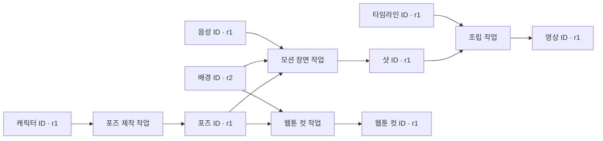

# 공유 원본을 사용하는 모션 영상 제작 확장팩 검토

2026-10-21. 사용자의 관점 보정에 따른 후속 검토다. **결정: 새 제작 확장팩으로 추진할 가치가 있다.**
세계관·자료·캐릭터·스토리·기존 그림을 선택해 재사용하고, 필요한 포즈·음성·음악을 보충해
움직이는 작품을 만드는 별도 흐름으로 검토한다. 첫 범위는 포즈·레이어·카메라 기반 모션 영상이다.
이번 변경은 검토 문서이며 확장팩·새 실행기·새 생성 기능을 구현한 것은 아니다.

**공통 자산 순환은 필수다.** 새 포즈·음성·음악·레이어·타임라인·샷·영상도 각각 공통 ID/판본으로
등록하고 원인 작업·고정 입력과 결속한다. 다른 제작 흐름은 같은 자산을 같은 ID로 재사용한다.
[공통 자산 ID·파생 그래프·재사용 계약](2026-10-21-creative-resource-lineage.md)에 현재 구현과 공백,
합성 연결 확인 결과 및 첫 구현의 필수 완료 조건을 기록한다. 완성 영상 파일만 돌려주는 구조로 만들지 않는다.

## 1. 이전 판단의 수정

[초기 감사](2026-10-21-content-production-harness-review.md)는 집필 엔진에 영상 하네스를 그대로
붙일 때의 중복·부적합에 무게를 뒀다. 이를 이유로 새 매체 제작 확장까지 보류한 것은 범위를 좁게 본 판단이다.
사용자의 의도는 핵심 원본을 공유하는 **추가 제작 경로**다. 현재 미지원이라는 사실은 구현할 일이 있다는
뜻이며 제품 적합성이 없다는 근거가 아니다. 입력/출력·리뷰·복구 감사의 사실은 유지한다.

보조 production-ready의 `CONTEXT.md`도 작업 공간을 하나의 책에 한정하지 않고, 핵심 원본·표현 프로필·
변형 결과물·고정 입력 묶음·파생 관계를 구별한다. 아키텍처 v2의 제품 방향은 범용 Core + Domain Packs다.
이 목적에는 새 제작 흐름을 추가하는 해석이 더 잘 맞는다. 이 문서는 기존 정본을 대체하지 않는다.

## 2. 어떤 확장팩인가

가칭 **모션 영상 제작 확장팩(`motion-story`)**. 기존 원작을 각색하거나 같은 세계관의 새 이야기를
만들고, 캐릭터 포즈·레이어·장면 배치·타이밍·선택적 오디오를 구성해 영상으로 출력한다.
매 프레임을 따로 그리거나 생성하는 제작을 전제로 하지 않는다. 포즈 교체, 위치/회전/크기 변화,
눈·시선·고개·작은 변형, 배경 이동과 컷 편집을 조합한다. 세부 연기 범위는 준비된 자산에 달린다.

도식의 모든 관리 자산은 같은 공통 자원 공간의 ID/판본을 가진다. `r1/r2`는 설명용 판본 표기다.
새 결과가 공통 자원으로 등록되는 것, 검토/입력 채택되는 것, 세계관 정본으로 채택되는 것은 별개다.
기존 그래프 화면이 이미 이 모든 파생 관계를 보여준다는 뜻은 아니다. 필요한 공통 조회/뷰도 수용 범위에 포함한다.
웹툰은 모션 영상의 선행 필수 단계가 아니다. 같은 원본에서 각각 출발하거나 선택한 결과만 연결한다.
낭독 영상도 동일 오디오·장면 자산을 쓸 수 있지만 새 스토리 작성이나 캐릭터 연기를 의무화하지 않는다.

## 3. 공유할 것과 제작별로 정할 것

| 대상 | 공유 가능한 기준 | 이번 제작에서 정할 표현 |
|---|---|---|
| 세계관·자료 | 선택 판본, 고정 규칙, 정확한 근거, 관점/추론 구분 | 다룰 사건·장면·독자·설명 범위 |
| 캐릭터 | 안정 ID, 외형의 고정 사실, 기준 그림, 관련 원작 | 등장 시점, 의상/소품 상태, 포즈·표정·연기·크롭 |
| 스토리 | 기존 원고·웹툰 대사/사건의 정확한 판본 | 그대로 낭독/각색/새 이야기 중 선택, 컷과 발화 순서 |
| 음성 | 원본 녹음, 선택 캐스팅, 언어·역할·모델/설정·이용 범위 | 이번 대사·감정·쉼·시작/끝·편집 구간 |
| 음악·효과음 | 원본 파일과 출처, 허용된 사용 범위, 기존 선택 이유 | 분위기·진입/퇴장·믹스·필요 여부 |
| 포즈·배경·소품 | 원본 판본, 실제 제작/편집 출처와 사용 조건 | 앵커·크기·카메라·접촉·앞뒤 가림·분리 레이어 |
| 결과물 | 공통 ID/판본·원인 작업·입력/출력 관계·파일 hash·제작/렌더 설정 | 다른 표현에서 채택할지, 어디까지 다시 검토할지 |

같은 캐릭터라도 모든 작품의 포즈·성격 표현·목소리를 하나로 잠그지 않는다. 캐스팅과 스타일에는 적용 범위가 있다.
원작의 ‘비 맞기 전’ 컷과 ‘젖은 뒤’ 장면을 같은 얼굴이라는 이유로 섞지 않는다. 각 등장 인스턴스가
어떤 장면/시점/관점의 상태와 자산 revision을 쓰는지 고정해야 한다. 추적의 `timeLabel/pathLabel`은
이름표이며 모든 발췌 시점의 완전한 상태를 자동 계산하는 엔진이라고 주장하지 않는다.

자료는 이야기 재료일 수도 사실 설명의 근거일 수도 있다. 이용 목적·선택 이유를 구별하고,
영상 각색의 새 설정/발화를 원작의 사실로 역기록하지 않는다.

## 4. 웹툰 재사용의 실제 단위

| 가지고 있는 것 | 바로 가능한 사용 | 추가로 필요한 작업 |
|---|---|---|
| 완성 컷 한 장 | 정지 장면, 팬/줌, 컷 전환, 낭독 배경 | 인물만 이동하려면 분리·가려진 배경 복원/새 배경, 문자 처리 |
| 투명 캐릭터 + 배경 | 위치/회전/크기, 앞뒤 레이어, 간단 바운스 | 발/손 접촉 앵커, 피벗, 포즈 전환 시 정렬 |
| 여러 포즈·표정 | 포즈 교체와 표정 변화, 간단 대화 | 동일 인물/의상·재질, 전환 타이밍과 가림 검토 |
| 얼굴/몸/팔다리 분리 | 눈·고개·입·팔다리 일부 연기 | 리그/접합·관절·그려지지 않은 부분 보충, 최종 크롭 검토 |
| 웹툰 대사·컷 순서 | 각색의 입력 근거 | 말풍선 제거/분리, 발화자·발화문 고정, 영상 시간과 구도 재구성 |

완성 컷이 있다는 사실과 자유롭게 움직일 캐릭터가 있다는 사실은 다르다. 기존 컷은 원본으로 보존하고,
배경 복원·레이어 분리·포즈 추가·무자막 버전을 새 파생 자원으로 만든다. 새 포즈/표정은 웹툰에서도
선택해 재사용할 수 있다. 첫 단계는 같은 작업 공간 안의 재사용이고, 다른 작업 공간의 자동 공유는 별도 범위다.

## 5. 제작 흐름과 부족한 자산의 처리

공통 흐름 후보는 **목표/입력 선택 → 각색·스토리와 장면 계획 → 자산 점검 → 필요한 제작 →
짧은 동작 시안 → 전체 러프 → 선택적 최종 오디오 → 조립·감상·수정 → 로컬 결과 인계**다.
고정 12단계를 모든 작업에 순서대로 돌리는 방식이 아니다. 이미 확정된 것은 재사용하며 필요한 결정만 묻는다.

| 상황 | 처리 원칙 |
|---|---|
| 원고와 대사가 이미 있음 | 선택 판본을 고정하고 각색 필요 여부부터 결정. 새 스토리 생성을 강제하지 않음 |
| 세계관/캐릭터만 있음 | 새 스토리·장면·대사는 제작 후보로 만들고 기존 정본과 구별 |
| 필요한 포즈/배경/발화가 있음 | 실제 판본·범위·이용 조건과 품질을 확인해 재사용 |
| 필수 자산이 없음 | 필요한 항목만 생성/사용자 파일/수정 등 가능한 경로로 보충. 실행 권한 없으면 해당 작업만 대기 |
| 선택 음성·음악이 없음 | 생략 또는 대체가 허용된 제작 설정이면 그 버전으로 진행하고 결과에 명시 |
| 대사 연기가 핵심인데 음성이 없음 | 무음 완성으로 조용히 바꾸지 않음. placeholder 러프와 최종 완료를 구별 |
| 포즈를 늘리기 어려움 | 허용된 정지/카메라 중심 시안으로 축소 가능. 약속한 동작을 했다고 표시하지 않음 |

선택 항목의 생략은 누락이 아니라 제작 설정의 선택이다. 다만 필수 입출력 hash, 영수증, hard 차단,
자기검토 표기와 soft 비자동수정은 선택 사항이 아니다. 기능 미사용과 실패·미관찰도 구별한다.
음성·음악을 최종 확정하기 전에 짧게 들어보고, 장면과 발화 길이는 러프에서 함께 맞춘다.
최종 음성 뒤에도 필요한 타이밍은 다시 맞춘다. 모든 작업에 무음 먼저라는 단일 순서를 강제하지 않는다.

## 6. 확장 구조: 세 책임을 나눈다

| Module | Interface가 맡을 일 | 맡기지 않을 일 |
|---|---|---|
| 기존 공통 관리 | 원본/판본 선택, 입력 snapshot, operation, 파생 관계, 검토·결정·복구 | 장르별 연기·타임라인 해석·공급자 선택 |
| 제작 확장팩 | 장면/등장 상태, 자산/단계/타임라인·매체 검토, 모든 관리 결과의 공통 등록·관계 결속 | 별도 사용자/자산/승인 기록장 만들기 |
| 실행 Adapter | 실제 이미지/음성/음악 생성·로컬 렌더·결과 식별과 관측 반환 | 원작/정본 자동 변경·품질 승인 대행 |

음성·음악 Adapter는 웹툰/모션/낭독 중 특정 하나의 소유물이 아니어야 한다. 제공자는 작업마다 고르고
동일한 캐릭터·대사/이용 목적의 선택 근거를 남긴다. Fish/Suno는 가능한 호스트 실행 경로의 사례다.
core는 계속 모델·네트워크를 호출하지 않으며 실제 도구 호출은 호스트/실행 Adapter 책임이다.

제작 확장팩의 최소 의미 계약 후보:

- **제작 설정:** 목적·출력 형식/길이·스타일·언어·사용할 원본·필수/선택 음성·음악·허용 축소·예산.
- **장면 계획:** 원작/발췌와 등장 상태의 판본, 등장 캐릭터, 행동·대사·장면의 역할, 필요한 자산.
- **자산 사용:** 실제 자원 revision/hash와 역할, 선택 포즈/크롭·레이어·앵커·사용 구간. 실제 사용한 입력만 계보에 포함.
- **타임라인:** 장면 순서·길이·카메라·포즈/연기·발화/음악/효과음·자막. 제작자에게는 초/행동 중심으로 표현 가능.
- **결과:** 파일과 hash, 실제 길이/화면/오디오 유무, 입력·렌더 설정 판본, 관찰 범위/미완료·수정 필요.

이는 제안하는 분야 JSON의 의미이며 현재 공개 MCP 인자에 임의 필드를 추가해도 된다는 뜻이 아니다.
하나의 거대한 범용 애니메이션 Interface를 먼저 만들지 않는다. 첫 제작 방식으로 검증하고,
실제로 두 번째 실행 방식과 달라지는 지점에서 작은 Seam과 Adapter 계약을 구체화한다.

## 7. 소스에서 가져올 구현과 새로 필요한 것

소스 `60291fa`의 `FilmV8.tsx`는 실제 시간에 따라 장면/크롭/카메라/자막을 구성한다.
`BounceFriendV7.tsx`는 SVG 캐릭터의 재질·몸·손과 바운스를, `ActingArtV8.tsx`는 그림의
미세 변형·눈/시선/고개·음성 진폭 기반 입 연기를 구현한다. 사용자 설명과 맞는 제작 방식의 실제 근거다.

하지만 인물 role이 dad/child이고, 색·좌표·눈 깜빡임/고개 시점·44초 구성은 특정 작품에 결속돼 있다.
새 캐릭터를 등록하면 자동으로 연기하는 범용 리그/확장팩이 이미 있다는 뜻은 아니다.
재사용할 것은 좌표계·접합·재질·전체 러프 검토 방법과 렌더의 일부 구현이며, 캐릭터/샷 입력을
데이터로 분리하고 앵커·가능한 연기·미지원 상태를 명시하는 작업이 필요하다. 진폭 입 연기는 음소 립싱크가 아니다.

하네스에서는 실제 입력·프롬프트 검토·출력에 결속한 리뷰·재개/무효화 방식을 가져온다.
새 확장팩의 품질 목표/실제 입력 packet으로 다시 작성하며 이전 인물·대사·음색·음악·장르를 복사하지 않는다.
의미가 맞는 순서로 검토를 옮기되 소스의 46개 계약 테스트를 범용 모션 확장팩의 검증으로 쓰지 않는다.

## 8. 기존 구현과의 접합, 남아 있는 공백

기능 근거는 읽기 전용 production-ready 작업 트리(`e7516d1` + 기존 미커밋 변경)다.
지정 `/Users/lyoojk/folio`의 오래된 집필 checkout에 새 엔진을 따로 만드는 것은 권하지 않는다.

| 이미 있는 것 | 활용 | 새로 확인/설계할 공백 |
|---|---|---|
| Resource/Revision/Input/Operation | 제작 설정·장면/타임라인 JSON·작은 미디어를 보관하고 정확한 입력과 결과 결속 | 단계별 의미·선택/의존·중단 상태를 자동 실행하는 전체 제작 런타임은 없음 |
| 기존 원고·lore/tracking·managed asset | 세계관/발췌/캐릭터·자산의 선택 입력 | 범용 Resource 경로와 독립적. 선택 판본을 전달하는 읽기 Adapter/bridge가 필요 |
| image 실행·검사 팩 | 추가 포즈/배경의 생성·검토 흐름 재사용 후보 | 포즈/레이어/리그·장면 상태 잠금·오디오/영상 검사·매체 출력의 별도 의미 계약 |
| 현재 pack registry | 기존 도메인 검사·프롬프트 배포 관례 재사용 | 첫 팩의 집필 pipeline이 primary이고 추가 팩이 임의 제작 실행기를 자동 설치하는 구조는 아님 |
| 범용 pipeline 정의 | transform/analyze 작업 정의를 버전으로 보존 | 현재 필드는 id/capability뿐. DAG·optional·render capability 지원으로 과장 금지 |
| Resource의 parents | 같은 Resource의 수정 이력 | 다른 자원의 파생 근거 목록이 아님. operation input/output으로 실제 계보 연결 |
| 기존 그래프/metadata | 원고 대상 연결 및 출력별 직접 inputRefs | 모든 제작 자산의 선행/후행 조회·그래프 뷰와 여러 단계 변경 영향 추적은 추가 필요 |
| 미디어 보관 | 작은 image/audio/video 바이트 보존 | Resource 개별 8MiB 제한. 긴 음원·최종 영상의 파일/객체 저장과 검증 계약 필요 |

따라서 **제품 의미의 확장팩**은 적합하지만 `packs/motion/pack.yaml` 하나를 추가하면 모두 실행된다고
설명하면 안 된다. 기존 공통 관리 위의 호스트용 제작 모듈·프롬프트·로컬 렌더로 작은 흐름을 검증한 뒤,
팩 등록/선택과 실행 진입점을 좁게 확장한다. 원본 bridge도 자동 전부 복사가 아니라 선택 판본의 보존이다.

현재 reserved profile은 scope/maxInputBytes 중심이다. 스타일·포즈 설정을 해당 정의에 임의로 넣지 않고
일반 JSON Resource의 분야 데이터로 보존한다. `schemaRef` 지정만으로 그 의미가 검증되지는 않는다.
입력 snapshot에는 실제 사용자 선택된 revision과 세 정의가 필요하고 실행은 기존 policy/grant 범위를 따른다.
권한을 새로 가진 것처럼 user 결정/위임을 만들어 기록하지 않는다.

8MiB 초과 영상을 JSON에 경로/hash만 넣어 ‘영상 bytes 보관/검증 완료’로 처리하는 우회는 금지한다.
초기 소형 시험과 향후 큰 미디어 저장 계약을 분리한다. 현재 external URI는 미관측 참조이고
operation 결과는 owned snapshot을 요구하므로 URI만으로 완성 영상 제출을 대체할 수 없다.

## 9. 스타일·용도와 미래 영상 생성의 확장

| 제작 형태 | 공유하는 기반 | 해당 형태의 중심 |
|---|---|---|
| 귀엽게 움직이는 캐릭터 | 캐릭터·포즈·타임라인·오디오 | 작은 바운스·반응·시선·표정. 과한 동작/접합 검토 |
| 종이극/컷아웃 | 같은 캐릭터/장면 참조와 오디오 | 종이 레이어·피벗·포즈 교체·그림자·가림 |
| 낭독 영상 | 선택 원고·음성·배경/그림·자막 | 실제 발음·쉼·문장/자막 일치·긴 호흡·읽기 편한 화면 |
| 모션 코믹 | 웹툰 컷·캐릭터·대사 | 컷의 재구도·말풍선 처리·발화자·제한된 움직임 |
| 향후 생성형 영상/혼합 | 장면 목표·캐릭터 참조·대사·선택 입력 | 샷 클립 생성/편집, 시간 연속성·동일성·변형과 이용 조건 |

장르(일상/판타지/공포 등), 그림 스타일(종이/크레용 등), 표현 방식(낭독/컷아웃 등)은 다른 축이다.
‘귀여움’이나 ‘모든 캐릭터가 흔들림’을 전역 품질 기준으로 두지 않는다.

미래 생성형 영상은 포즈/레이어 렌더와 내부 제어 가능성이 다르다. 공통으로 맞출 것은
**샷 목표/선택 입력과 검토 가능한 클립 결과**다. 생성 샷 하나와 로컬 컷아웃 샷을 같은 타임라인에
배치할 수 있게 하되 모든 Adapter에 관절/포즈 제어를 요구하지 않는다. 미지원 기능은 명시한다.
샷 결과의 길이·크기·fps·오디오 포함 여부를 실제 관측하고 다음 편집/믹스의 정합성을 확인한다.
새 생성형 영상 Adapter 자체는 첫 구현에 포함하지 않는다.

## 10. 권하는 첫 도입 범위와 수용 기준

1. **첫 모션 경로:** 선택된 캐릭터 1명·배경 1개·포즈 2개로 짧은 두 샷을 로컬 조립한다.
   완성 컷 입력과 투명 캐릭터 입력의 차이를 분명히 보여 주고 재사용/추가 제작 목록을 반환한다.
   모든 관리 결과의 공통 ID/판본·원인 작업 등록과 관계 조회를 먼저 또는 함께 검증한다.
   원본/상태 선택→장면 계획→작은 시안→전체 러프→검토·결과 인계의 한 경로를 검증한다.
2. **첫 오디오 연결:** 사용자 파일 또는 합성 음원으로 voice/music/sfx를 각각 선택적으로 연결한다.
   나중에 실제 생성 Adapter를 붙일 자리에 실제 대사·서비스 입력·결과 ID·중단 상태를 기록한다.
   기존 서비스 전역 기본값·임의 생성·자동 결제는 추가하지 않는다.
3. **두 번째 소비 경로:** 같은 캐릭터/배경/포즈를 모션 코믹 또는 낭독 영상에서 다시 선택한다.
   같은 ID/판본을 복제 없이 재사용하고 새 결과의 선행/후행 관계가 공통 조회에 나타나는지 확인한다.
   여러 단계 변경 영향도 수용 기준이다. 실제 두 실행 방식의 차이에서 Seam을 확정한다.
4. **제품 통합:** 사용하는 checkout·공통 관리와의 연결을 확정하고 필요한 팩 등록/진입점,
   큰 미디어 저장, 파생 관계·단계 복구·변경 영향 검사를 작은 변경 단위로 구현한다.

검증할 시나리오(아직 구현/실행하지 않은 수용 계획):

- **독립 제작:** 웹툰 없이 같은 캐릭터/자료로 새 두 샷을 만들 수 있다.
- **재사용:** 웹툰의 같은 입력 판본을 선택해 새 결과를 만들고 원작·컷·승인은 바뀌지 않는다.
- **자산 순환:** 중간/최종 결과 모두 공통 ID와 계보를 가지며, 모션의 포즈를 다른 팩이 같은 판본으로 읽어
  새 결과를 만든다. 포즈·음원·샷을 최종 영상 폴더 속 식별 불가능한 부속 파일로만 남기지 않는다.
- **선택 자산:** voice/music 미사용 버전이 가능하다. 필수 대사 음성 누락은 미완료로 구별한다.
- **부족한 포즈:** 보충 요청/허용된 축소/사용자 파일 중 선택하고, 자동으로 더 생성하지 않는다.
- **변경 영향:** 포즈 변경은 사용하는 샷/전체 인코딩·해당 검토에, 음성 길이 변경은 타이밍/자막/믹스에 영향을 준다.
  여러 단계를 거친 의존도 따라간다. 이는 현재 metadata가 자동 수행하는 기능이 아니라 추가 수용 조건이다.
  전체 결과의 새 hash에는 새 검토가 필요하고, 변하지 않은 원본 녹음·다른 샷의 제작 이력은 보존된다.
- **재개:** 렌더 재개는 같은 입력을 쓰며 서비스 성공 여부 미상에서는 기존 결과 식별부터 한다.
- **품질:** 작은 동작의 의미·접합·상태 일치·자막/발화/믹스를 실제 결과로 확인한다. 최종 파일 hash·실제 길이와
  필수 관찰 모드별 전체 구간을 검토에 결속한다. 무음 작품은 전체 시각 검토, 오디오가 있는 작품은
  전체 시각·청취·AV 검토를 적용한다. 짧은 시안/발췌만으로 전체 합격을 내지 않고 미관찰은 미완료로 남긴다.
  검토자에게 현재 입력·최종 파일·타임라인·필수 관찰 범위를 주며 제작자의 점수는 먼저 주지 않는다.
  같은 호스트의 검토는 자기검토로 유지한다. 감정/매력은 사람이 실제 결과를 보고 판단한다.

이 첫 범위의 가치는 기록량보다 **동일 캐릭터로 다른 작품을 쉽게 만들고, 이미 만든 것을 안전하게
재사용하며, 빠진 것만 보충하고, 수정 비용을 줄이는지**로 평가한다. 실제 미감·생성 품질과 시간 절감은 미측정이다.

## 11. 이번 검토에서 확인한 것

읽기 전용 소스 HEAD는 계속 `60291fa`, 미추적 `projects/off-duty-pattern/`은 제외했다.
소스의 실제 Remotion/React/SVG 구현과 manifest, 보조 checkout의 CONTEXT/아키텍처·Resource·
팩/이미지 실행·추적 코드를 확인했다. 다른 worktree의 기존 변경은 수정하지 않았다.

Node 24.19.0에서 기존 순수 검증 함수에 합성 입력만 전달한 오프라인 확인 5건:

- 현재 pipeline의 transform/analyze 단계 정의: 수락.
- render capability: 거부.
- 의존/optional 필드가 있는 단계 정의: 거부.
- reserved profile에 style 추가: 거부.
- 일반 JSON Resource에 장면/스타일 데이터: envelope 수락. payload 의미 검증은 별도임을 확인.

이 확인은 새 확장팩의 렌더/재개·공개 MCP 종단 테스트가 아니다. 실제 생성·새 영상 렌더·청취·품질 A/B는
이번에 하지 않았다. 앞선 감사의 788/46 테스트는 그 당시 실행 기록이며 이번 문서 수정 뒤 재실행한 것으로 쓰지 않는다.
유료 호출·계정/인증·소스·승인 작품·업로드·제출은 변경하지 않았다. 새 문서와 초기 결정의 범위 설명만 보완했다.
같은 호스트의 별도 비평에서 최종 전체 구간/관찰 모드 수용조건 누락을 지적받아 반영했다.
후속 자산 순환 보완에서는 기존 함수로 결과→같은 ID의 다음 입력과 직접/전이 변경 영향 차이를 합성 확인했다.
실제 결과와 미구현 범위는 [공통 자산 계약 §7](2026-10-21-creative-resource-lineage.md)에 구별해 기록했다.

근거: 보조 checkout `CONTEXT.md`, `docs/plans/2026-10-08-architecture-audit/architecture-v2.md`,
`docs/resources.md`, `core/resources/{definitions,schema,input-snapshots,revisions}.js`,
`core/operations/{requests,publications}.js`, `core/pack/{registry,validate}.js`,
`core/image/{steps,references}.js`, `core/tracking/{observation-schema,snapshots}.js`.
소스: `projects/umbrella-friend/production/src/{FilmV8,ActingArtV8,BounceFriendV7,index-v8}.tsx`,
`projects/umbrella-friend/releases/v8-acting/manifest.json`, `docs/proven-production-process.md`와 `harness/`.
