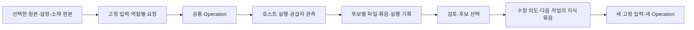

# Chroma 도구 입력 출력 조사와 리니베라 데이터 연결 구현 계획

2026-10-22 한국 시간. **목표: 여러 생성 도구의 원본·실제 입력·후보·선택·수정·사용 맥락을 연결해 짧은 반복 제작과 장편 연속 제작에 재사용한다.** 이 문서는 조사·구현 계획과 A–C 구현 기록이다. D–F의 구현과 검증 기록도 마지막 절에 이어 적었다.

## 읽는 순서와 기준

1. 이 문서: 전체 데이터 유형, 기존 PR와의 차이, 구현 순서와 수용 조건.
2. [공통 관리 계약](2026-10-22-chroma-data-contracts.md): 저장·묶음·실행 관측·후보별 승인·작업별 선택·지식 묶음의 필드와 불변식.
3. 공식 근거: [이미지·영상 10개](2026-10-22-chroma-io-image-video.md), [음성·편집·3D 7개](2026-10-22-chroma-io-audio-editing-3d.md), [워크플로·게임·지원 20개](2026-10-22-chroma-io-workflows-games.md).

Chroma의 37개 파트너 전체를 위 세 조사표에 중복 없이 배정했다. 회사 참여와 특정 제품/API 지원은 구별한다. 각 표는 실제 입력 필드·출력·식별자·API/UI export·미확인을 직접 공식 출처와 연결한다. 금액·멤버십은 [기존 혜택 조사](2026-10-21-chroma-awards-credits-research.md)에 두며 웹 구독을 API 잔액으로 해석하지 않는다.

설계 정본은 기존 착수 계획서다. 저장소가 가리키는 외부 정본 URL은 이번에도 열리지 않아 새로 대조하지 못했다. 아래 계획은 사용자 지시, [데이터 연속성 방향](2026-10-22-cross-tool-data-continuity.md), 확인한 PR/코드에 근거한다.

## 1. 이전 PR에서 재사용할 기반

기준은 [PR #2 공통 자산 계보·재사용·변경 추적과 모션 제작 확장팩 연결](https://github.com/fbwndrud/linivera/pull/2)이다. 확인 시 open·미병합이며 head `891568ed7740df844bc5af5a53e138d98bf3dc78`, base `656e437`이다. 로컬 `resource-motion/folio` head와 일치한다.

| 구현되어 있는 것 | 재사용 방식 | 이번에 추가할 것 |
|---|---|---|
| Resource ID·불변 revision·content hash | 모든 데이터의 같은 식별·저장 기반 | 큰 파일·다양한 MIME·복수 파일 묶음 |
| importFile/importAsset | 파일 반입·기존 자산 ID 유지 | 웹/코드/3D/편집 자료의 안전한 반입·완전성 |
| Input snapshot·정의/정책 고정 | 실제 입력과 사용자 선택·권한 검증 | 역할별 참조 폐쇄 검증, 작업 범위 선택, 같은 자원의 판본 비교 |
| Operation·결과·영수증·결정 | 기존 잠금과 불변 최종 결과 | 공급자 실행 관측, 부분 결과, 후보별 출력·승인 그룹 |
| 그래프·전이 변경 영향 | 입력/출력/revision과 재검토 경로 | 미제출 관측 결과·새 그룹·사용/포함 관계 |
| 모션의 샷/타임라인/영상 결속 | 다음 제작이 같은 자산을 읽는 실제 소비자 | 다른 공급자 데이터에서도 같은 재사용 성립 |

코드 근거: [저장·revision](/Users/lyoojk/.codex/worktrees/resource-motion/folio/core/resources/revisions.js), [입력](/Users/lyoojk/.codex/worktrees/resource-motion/folio/core/resources/input-snapshots.js), [작업](/Users/lyoojk/.codex/worktrees/resource-motion/folio/core/operations/requests.js), [승인](/Users/lyoojk/.codex/worktrees/resource-motion/folio/core/operations/publications.js), [계보](/Users/lyoojk/.codex/worktrees/resource-motion/folio/core/query/resource-graph.js), [상태 재생](/Users/lyoojk/.codex/worktrees/resource-motion/folio/core/publications/state.js).

구현 시 PR #2가 열려 있으면 그 head를 기반으로 의존 관계를 명시한다. 병합됐으면 해당 변경이 들어간 최신 main을 확인한다. 현재 `/Users/lyoojk/folio`의 오래된 집필 체크아웃에 새 기반을 중복 구현하지 않는다. 이 계획 작성 중에는 branch 전환·PR 수정·병합을 하지 않았다.

## 2. 조사에서 도출한 데이터 유형

| 유형과 대표 도구 | 실제로 연결할 데이터 | 공통 관리 방법 |
|---|---|---|
| 이미지/영상: fal·Runware·Kling·OpenArt·Dreamina·MiniMax·PixVerse·LTX·Luma·Magnific | prompt/설정, 참조 이미지·마스크·first/last frame·동작, 파일·seed(있는 경우), job/asset ID | 역할별 입력 판본→실행 관측→각 후보. 변환/확대/프레임 추출도 파생 작업 |
| 음성/정렬: ElevenLabs·VEED·Creatify | 발화문·voice 설정·이미지·오디오, 결과 audio/video, 문자/단어/화자 alignment | 오디오와 정확한 텍스트·정규화 대응·timebase를 함께 결속 |
| 편집: CapCut·Adobe·Martini | 원본 미디어·자막·타임라인·template, 최종 MP4와 프로젝트/AAF/XML 등 | 최종 렌더와 재편집 소스를 구별해 묶음으로 관리. 확인된 export만 지원 |
| 3D: Meshy·Hyper3D | 순서/시점 있는 참조, mesh·texture·PBR·rig·animation·embedded clip | 파일별 ID/판본+상대경로/역할 manifest, 생성 단계별 계보 |
| workflow/복합 실행: Floyo·Martini·TapNow·Oxen·Fixed Seed·Alibaba Cloud | 편집용 graph·실행 graph·모델/노드/입력·run/action·부분 결과·외부 repo 판본 | 정의와 실제 실행을 분리. 각 action/input이 확인될 때만 세부 의존을 결속 |
| 실시간/대화: Reactor·Cantina·Pickford | session·명령/관객 입력 순서·상태·media track·보존 구간 | session manifest와 시간순 실행 기록. 완전 복원 여부는 관측 범위로 표시 |
| 코드/게임/스프라이트: Rosebud·Bolt·Nimble Fox·SpriteCook | source·lockfile·소재·build·spritesheet·frame/character ID·외부 상태 | 파일 묶음과 사용 관계. source/build/게시 주소·DB 상태는 별개 |
| 배급/지원: ReelShort·Fairground·Escape·Wonder·Cars24·Ashurst Perkins Coie·Passionfroot | 실제 전달된 브리프·권리 문서·납품/공개 참조·제작기 | 일반 자료와 외부 참조로 연결. 생성 커넥터를 만들 대상으로 세지 않음 |

회사/제품은 여러 유형에 걸칠 수 있다. 37개 전체의 확인 범위는 조사표가 기준이며 위 표는 구현 책임을 묶는 분류다. TapNow·Pickford·일부 게임 도구 등의 공개 API/export가 미확인인 곳은 우선 파일·수동 출처 반입 경로를 사용한다.

**계약을 바꾸는 핵심 사실:** URL만 남기면 결과가 사라질 수 있고, workflow의 편집 graph와 실행 graph는 다르며, 하나의 run이 실패해도 쓸 수 있는 부분 결과가 생긴다. 최종 영상은 편집 소스와 다르고, 오디오 정렬은 해당 음원·발화문에 묶여 있다. 도구별 공식 근거는 위 세 조사표에 있다.

## 3. 데이터가 이어지는 방식

기존 core가 검증·저장·조회하고, 외부 실행은 호스트/Adapter가 맡는다. 생성 성공·파일 보존·형식 관측·품질 검토·입력 선택·정본 채택을 구별한다. 모든 생성 도구에 별도 자산 저장소나 승인 경로를 만들지 않는다.

동일 생성의 후보별 manifest+파일은 같은 실행과 연결한다. A 후보의 음원에 B 후보의 정렬을 붙이지 못하게 출력 그룹을 검사한다. 후속 편집/변환/조합은 실제 선택한 판본을 입력으로 새 Operation을 만든다. 미채택 후보도 비교·수정 근거로 보존한다.

## 4. 구현 작업과 PR 분할

아래 경로는 PR #2와 같은 저장소 구조를 기준으로 하는 변경/신규 파일 제안이다. 파일당 300줄 이하를 유지하고 책임별로 나눈다. 모든 수용 검사는 합성 fixture와 가짜 공급자 응답을 사용한다.

### PR A 큰 파일·형식·복수 파일 반입

**파일:** 기존 `core/resources/{schema,revisions,files,intake}.js`, `server/tools/resources.js` 확장. 신규 `core/resources/{blob-files,media-types,bundles,bundle-import}.js`, 선택적 `adapters/artifacts/local-observer.js`. `test/resources/{blob-files,bundles,resource-v1-compat}.test.js`.

- [x] v1 hash를 그대로 검증하고 v2 파일 envelope/stream reader·writer·내용 검사 추가.
- [x] SRT/VTT/CSV/XML/AAF/3D/프로젝트/source 등 확인된 파일을 opaque 또는 typed 데이터로 반입. 검증 수준 반환.
- [x] 묶음 manifest·필수 멤버·경로·중복·완전성 검사. 같은 자산의 재반입은 같은 ID/판본 유지. 선언 파일 보존과 의존 범위·프로젝트 복원 가능성을 따로 표시.
- [x] metadata `describe`와 명시적 로컬 `materialize`를 추가하고 큰 base64 응답 방지. 기존 작은 `read`는 호환.
- [x] 기존 profile/policy `maxInputBytes`에 묶음 내부 실제 파일·정의 bytes까지 포함.

**완료:** 음원+alignment, 모델+PBR+rig/clip, 편집 XML+소재, 게임 source+build를 반입·재조회·다른 제작 입력으로 사용한다. 8MiB 초과 합성 파일을 스트림 처리하며 파일 손상·누락·원본 변경은 오류/불완전 상태로 드러난다. 기존 v1 판본과 영수증은 변하지 않는다.

### PR B 실제 요청·실행 관측·후보별 결과 관리

**파일:** 신규 `core/operations/executions/{schema,append,replay,bindings}.js`, `core/operations/{output-groups,group-publications}.js`, `core/resources/reference-closure.js`, `packs/production/{request-schema,artifact-schema}.js`. 기존 `requests.js`, `lineage.js`, `publications/state.js`, `projections/metadata.js`, `server/tools/operations.js` 확장. `test/operations/{executions,output-groups,partial-lineage}.test.js` 및 reference closure 검사.

- [x] 공급자 고유 설정을 보존하는 generation-request Resource와 실제 전송 field/역할/판본 mapping 검사.
- [x] Operation 요청에 계약 버전과 requestRevisionId를 hash 결속. v2의 legacy 경로·v1의 group 경로·중복 publication을 거절.
- [x] 추가 전용 execution 기록, 외부 job/subjob ID·상태·오류·회수·부분 결과·불명 필드·관측 수준.
- [x] v2 후보 그룹의 `submitGroup/reviewGroup/decideGroup`. 결과를 sealed execution prefix·request digest·출력 명세와 결속. v1 전체 출력 승인 계약 유지.
- [x] 고정 후보와 dynamic action/item 출력 규칙을 구별. 허용된 규칙 안에서만 native ID→groupId를 추가 전용으로 대응.
- [x] final submit 전 관측 산출물도 producer·입력을 조회하고 변경 영향을 전파하되 승인 metadata로 승격하지 않음.
- [x] lost-ack는 submission-unknown, 다운로드 재시도는 같은 job 회수, 새로운 생성은 새 Operation으로 구분.

**완료:** 3개 후보 중 A는 hard 지적, B는 승인, C는 수집 불완전인 상태를 각각 유지한다. 실패한 복합 run의 부분 파일도 원인·입력·선택 이력을 잃지 않는다. 임의 파일을 실행 출력처럼 결속하거나 다른 후보의 alignment를 붙이면 거절한다. 재시작 뒤 같은 외부 job을 회수하며 중복 생성하지 않는다.

### PR C 서로 다른 두 도구로 공통 Interface 검증

**파일:** 신규 `adapters/production/{fal,elevenlabs,manual-capture}.js`와 endpoint별 mapper/validator, `adapters/production/{collect,transfer-map}.js`. 기존 MCP 입력/출력 계약과 host 가이드 갱신. `test/adapters/production/*.test.js`, `test/server/production-capture-e2e.test.js`.

- [x] fal 대표 queue 이미지 생성의 request_id·다중 이미지 후보·실제 파일 회수 mapping.
- [x] ElevenLabs TTS-with-timestamps의 발화문/voice/settings·오디오·문자 alignment mapping. 단어 정렬은 별도 capability.
- [x] 웹 UI/사용자 파일은 manual capture로 반입. 실제 알 수 없는 prompt·seed·원래 입력은 unknown으로 남기고 관측하지 않은 생성 provenance를 만들어 내지 않음.
- [x] 공급자 API를 호출할 호스트 Interface와 core 저장 Interface를 구별. endpoint·schema 확인일·native payload 보존.
- [x] 네트워크 실행 Adapter는 별도 자격정보를 사용하며 기존 host grant를 유료 생성 결제 승인으로 해석하지 않음. 이번 구현 검증에는 외부 생성 호출 불필요.

**완료:** 같은 MCP 관리 흐름으로 비동기 이미지 후보와 동기 오디오+정렬을 수집·검토·선택·다른 작업 입력으로 전달한다. 가짜 transport의 호출 횟수로 lost-ack/retry 동작을 검증한다. signed URL이 만료된 뒤에도 이미 보존한 결과를 오프라인에서 읽는다.

### PR D 반복 수정과 작업 범위의 판본 선택

**파일:** 신규 `core/resources/{input-selections,input-snapshots-v2}.js`, `core/operations/iteration.js`. PR B의 `reference-closure.js`와 기존 `publications/state.js`, `resources/input-snapshots.js`, `projections/review-impact.js`, `server/tools/inputs.js` 확장. `test/resources/{scoped-inputs,reference-closure}.test.js`, `test/operations/iteration.test.js`.

- [x] `input-selection` marker와 stable bindingKey, fixed/global/scoped 선택 dependency를 구현. 실제 사용자 지시·현재 권한을 검증.
- [x] v2 prepare/verify에서 정확한 checkpoint·판본·내부 참조 폐쇄 집합·파일 예산을 봉인. v1 계약 유지.
- [x] 같은 Resource의 옛/새 판본을 역할별로 비교 가능하게 하고 전역 기준 선택을 뒤집지 않음.
- [x] 유지할 기준·변경 요청·이전 선택을 iteration Resource로 묶어 다음 작업에 전달.
- [x] fixed는 직접 선택 drift만 면제하며 기존 상위 입력의 전이 재검토는 유지. scope 안 무관한 binding 변경은 직접 영향에서 제외.

**완료:** ‘표정만 수정’으로 새 후보를 만들고 이전 선택을 복원한다. 8화가 고정한 1화 얼굴 판본을 새 세션에서 사용하며 9화의 입력 선택과 충돌하지 않는다. 원작 공통 기준 변경은 관련 결과에 재검토 경로를 남긴다. 사용자 선택·품질 승인·정본 채택은 섞이지 않는다.

### PR E 사용 맥락·다음 작업의 지식 묶음

**파일:** 신규 `core/resources/{usage-bindings,alignment-bindings}.js`, `core/context/{collect,package,budgets}.js`. 기존 tracking/원고 ID bridge와 `server/tools/resource-query.js` 연결. `test/context/{continuity,budget,scope-isolation}.test.js`, `test/server/cross-session-production.test.js`.

- [x] 회차·장면·시점·경로의 선택 상태와 근거·미확인을 판본 있는 사용 맥락으로 연결.
- [x] alignment를 audio/text/normalized text/map/timebase에 직접 결속. 다른 판본에 붙이면 거절.
- [x] 다음 작업의 지식 묶음을 관련 원본·선택 결과·유지 기준·변경 의도·근거로 구성. 요약/추천은 별도 후보로 표시.
- [x] 예산에 맞는 text·파일 manifest/프리뷰 참조를 반환하고 missing/unknown/truncated를 명시. 대형 미디어 전체를 모델 문맥에 넣지 않음.
- [x] 선택한 지식 묶음과 실제 제공 원본을 새 Input으로 고정해 문맥 기록이 생성 계보와 이어지게 함.

**완료:** 호스트 대화 기록 없이 새 세션에서 다음 회차의 얼굴·목소리·해당 경로 사건·소품 상태를 찾는다. 다른 경로의 상태를 섞지 않는다. 근거 부족/모호한 상태를 임의 확정하지 않고, 요약 원문과 과거 선택을 추적할 수 있다.

### PR F 데이터 유형 확장과 같은 조회 화면

**파일:** `adapters/production/{meshy,martini,floyo}.js` 등을 필요한 순서대로 추가. 신규 `core/operations/session-records.js`는 실제 live 수집을 구현할 단계에 추가. 기존 `core/query/resource-graph.js`, `core/view/resource-graph.js`, viewer의 Resource/Graph 화면, `examples/production-continuity.js` 확장.

- [x] Meshy/Rodin 복수파일, Martini workflow·run·부분 결과, Floyo 편집/실행 graph를 우선 검증. 조사표가 불명확한 API는 웹 파일 반입을 유지.
- [x] 그림·동작·음원·3D·workflow·code를 같은 그래프에서 조회하며 causal input/output과 contains/usage를 구별.
- [x] 실행 event head·result catalog digest를 query coverage에 포함. 여러 회차에서도 페이지/예산·누락을 명시.
- [x] 큰 파일은 실제 사용/내용 검증 때 streaming hash로 확인한다. metadata-only 관측을 내용 검증 완료로 표시하지 않는다. 범위 조회용 파생 index로 관련 판본부터 찾되 반환한 관계·파일은 재검증하고 기본 검사를 조용히 생략하지 않음.
- [x] 게임은 source/소재/build를 보관하며 DB·플랫폼 외부 상태의 누락을 표시. live는 명령 순서·관측 구간·파일 보존부터 시작.
- [x] 영어/한국어 기존 화면과 정적 viewer export 호환. 도구별 UI를 새 정본으로 만들지 않음.

**완료:** 합성 예제로 한 소재를 두 제작 흐름에서 같은 ID/판본으로 쓰고, 수정→다음 회차→사용처 조회까지 검증한다. live 제어·모든 native 포맷 파서·모든 회사 API 자동 호출을 이 PR에 몰아넣지 않는다.

## 5. 의존 관계와 먼저 낼 범위

`A → B → C`가 첫 전달 범위다. `D → E`가 반복 제작과 장편 연속성의 다음 전달 범위이며 `F`는 확인된 데이터 유형별로 나눈다. PR A의 작은 파일/manifest 계약과 PR B의 요청 schema는 먼저 함께 고정한다. B는 기존 v1 선택에 대해 typed 내부 참조를 검사하고, D에서 같은 closure helper를 작업 범위 선택·다중 판본으로 확장한다.

첫 범위부터 여러 파일과 후보별 선택을 포함한다. 단일 이미지 한 장의 파일명과 URL만 저장하는 구현을 전체 계약 완성으로 보지 않는다. 자동 API 실행을 추가하지 않아도 수동 파일 반입·실행 관측 전달로 공통 관리의 수용 조건을 검증할 수 있다.

## 6. 필수 수용 검사

| 사례 | 반드시 확인할 결과 |
|---|---|
| 옛 Resource/영수증/모션 예제 | v1 hash·기존 공개 도구·승인 잠금 유지 |
| 큰 파일·모델/텍스처 묶음 | stream 저장, 정확한 내용 검사, 필수 멤버 누락 표시 |
| 같은 bytes·다른 논리 자산 / 같은 job 재회수 | 저장 dedup과 논리 ID 구별, 중복 후보 생성 방지 |
| 문자 alignment·새 발화문·다른 음원 | 정확한 text/audio/timebase 결속, 잘못된 재사용 거절 |
| 생성 POST 응답 유실 | 외부 생성이 재실행되지 않고 조정 필요 상태로 남음 |
| run 실패·일부 후보 완성 | 부분 계보/사용처 유지, 후보별 검토, 완료/승인 오표시 없음 |
| 전역 선택·작업별 고정·서로 다른 경로 | 선택 충돌 없음, binding별 직접 영향과 기존 전이 영향 유지 |
| 새 호스트 세션·문맥 예산 초과 | 관련 판본을 근거와 함께 회복, 누락·잘림 명시 |
| 새 metadata/marker·기록 손상 | 구버전은 호환 오류, 새 버전은 옛 prefix 재현, 손상은 fail-closed |
| v2 작업을 legacy 경로로 제출·승인 | 요청 계약 버전 불일치로 거절, group hard/실행 결속 우회 불가 |
| dynamic run·완전한 파일/미확인 외부 의존 | 허용된 그룹만 등록, 파일 보관 완료와 복원 가능성 별도 표시 |
| hard 지적·철회/만료 grant·self-review | 모든 새 실행/그룹에서도 기존 잠금 우회 불가 |

각 PR은 새 module의 Interface 검사와 실제 stdio MCP 경로를 확인한다. 변경한 core/server에는 `npm run check`, viewer 변경에는 viewer test/build, 마지막에는 합성 continuity 예제를 실행한다. 문서에는 실제 수행한 검증과 실제 외부 실행 여부를 구별해 기록한다. 계획 작성 단계에서는 제품 테스트를 새로 실행한 것으로 보고하지 않는다.

## 7. 실행 전 확정할 계약과 완료 상태

표와 [상세 계약](2026-10-22-chroma-data-contracts.md)이 필드/상태/수용 조건의 구현 초안이다. 첫 구현에서 endpoint의 현재 스키마를 다시 고정하고, 실제 코드 차이가 드러나면 이 계획을 함께 갱신한다. 실행 Adapter가 없는 도구의 데이터도 공통 반입으로 이어 관리할 수 있어야 한다.

최초 조사 완료물은 37개 파트너의 공식 I/O 조사 3개, 공통 데이터 계약, PR별 구현 계획이었다. 이후 사용자 지시에 따라 A–C를 한 후속 PR로 구현했다. 가입·크레딧 발급·유료 생성은 실행하지 않았다. 기존 사용자 변경과 읽기 전용 이식 원본은 그대로 두었다.

## 8. A–C 구현 기록

기반은 PR #2 head `891568ed7740df844bc5af5a53e138d98bf3dc78`이며 후속 branch는 `codex/chroma-data-abc`다. 기존 Resource/Input/Operation/영수증·결정/모션 구조를 확장했다. 현재 호출 가능한 사용법은 [생성 데이터 안내](../production-data.md)와 실제 공개 MCP 예제 `examples/production-continuity.js`가 기준이다.

- A: v1 golden hash 유지, 큰 파일 v2 스트리밍, 일반 MIME 보존·검증 수준, 중첩 묶음 closure와 선택/scope/예산 검사, describe 및 단일 판본 새 파일 materialize. 음원·정렬, GLB·PBR·rig·clip, 편집 XML·영상, 게임 source·lockfile·build 합성 묶음 roundtrip을 검증했다.
- B: versioned generation-request와 v2 Operation 결속, append-only 실행 ledger, fixed/dynamic 후보 그룹, manifest 포함 후보별 영수증·독립 결정, typed audio/text 정렬 결속, 미제출 관측 결과의 전이 계보, metadata v4와 이전 generation 읽기를 구현했다. hard 차단·권한 철회·SIGKILL 복구·prefix/hash/다른 후보의 파일 혼용 거절을 검증했다.
- C: fal `fal-ai/flux/schnell`, ElevenLabs TTS-with-timestamps, manual capture를 주입 transport Interface로 구현했다. native 저장본 redaction, 정확한 text bytes, 안정 ID, lost-ack 후 재POST 차단, 부분/반복 회수 및 호스트 recorder를 검증했다.
- 실제 stdio MCP 통합: 요청/입력 고정→이미지·음원·문자 정렬 회수→검토/합성 선택→서버 재시작→기존 모션 샷/타임라인/음성 영상→최초 prompt 변경의 전이 재검토까지 검증했다. 회수 후 이미지 URL을 사용할 수 없게 만들어도 후속 작업은 보존 파일을 소비한다.

명세를 구체화한 차이: execution 이벤트는 operation별 ledger의 `executionId`와 정확한 head에 결속한다. `inspect`는 상태/events와 불변 submittedGroups를 제공해 재회수 때 기존 제출을 재사용한다. `requestDigest`는 민감한 필드를 가린 native JSON 저장본의 hash다. 원문 literal 재현이나 공급자 내부 실행 증명으로 표시하지 않는다. 단일 파일/묶음 상한은 이번 구현에서 상수이며 설정 UI를 추가하지 않았다.

A의 materialize는 판본별 단일 파일 사본이다. 전체 묶음 디렉터리 복원, archive 추출, 도메인별 프로젝트 실행, 실제 공급자 계정/유료 생성 검증은 이번 범위에 포함하지 않는다. ElevenLabs 동기 응답은 호스트 세션 종료 전에 회수해야 하며 로컬 MCP 서버 재시작과 구별한다. 이 시점에는 D–F가 미구현이었으며, 후속 구현은 아래 9절을 따른다.

최종 검증: Node 24.19.0에서 `npm run check`의 ESLint·전체 타입 검사·테스트 **1,837/1,837 통과**(skip 0). 전체 검사 안의 `package:verify`는 새 tarball을 개발 의존성 없이 설치하고 새 continuity 예제까지 통과했다. viewer build와 기존 모션/공개 MCP·HTTP·CLI·Web/EPUB 경로도 이 검사에 포함된다. 수정 파일은 모두 300줄 이하이며 실제 작품·생성 결과는 커밋하지 않았다. 독립 검토에서 발견한 복합 자격 키 redaction 누락과 위조 pinned bytes는 회귀 검사 및 동일 재현의 재검증으로 차단을 확인했다.

## 9. D–F 후속 구현

사용자의 후속 지시에 따라 PR #3 head `7ebf6bc6728548306f4380441e69765119767714`를 기반으로 `codex/chroma-continuity-def`에서 D–F를 구현했다. 사용자 작업 체크아웃과 읽기 전용 이식 원본은 수정하지 않았다. 현재 사용법은 [회차 연결 안내](../continuity.md)와 `examples/scoped-continuity.js`다.

- D: 사용자 scope 선택 marker와 fixed/global/scoped dependency, v2 snapshot·동일 Resource 다중 판본 비교·전이 변경 영향, iteration과 과거 선택 복원, readonly getSelection, 모션 restrictInput의 고정 선택 유지. 옛 v1 hash와 metadata v4를 읽으며 새 metadata는 v5다. 새 typed context/iteration의 fresh v1에는 referenceClosureVersion을 고정해 내부 참조 우회를 막는다.
- E: scope/path/time별 usage-context와 resource-usage, 실제 원고/추적의 Resource·body hash bridge, 정확 audio/text/normalized map/timebase 검사, 예산 있는 context-package preview와 제공 자료/누락 구분. 품질 승인이나 자동 정본 채택은 만들지 않는다. package의 주 자료를 다른 evidence로 바꾸거나 원문·tracking·누락 coverage를 위조하면 거절한다.
- F: Meshy preview 대표 API의 주입 transport, Rodin/Floyo/Martini/game의 자체 버전 수동 export, 부분 묶음→재시작→추가 회수→완전 제출, 세션 명령 순서·관측 구간·누락·미디어 판본의 MCP 관리. 공식 불명확한 실행 API를 추정하지 않았다. 실제 확인한 endpoint와 제한은 Adapter 상수와 사용 안내에 기록했다.
- 조회: 자료 유형·회차 선택 필터와 usage/contains/context/iteration/session 관계를 같은 영어·한국어·정적 그래프에서 구분한다. cursor·페이지 경계·관계 예산/누락, 명시적 부분 탐색 index를 추가했다. 기본 graph는 전체 hash 검증을 유지하고 indexed query는 반환 관계·파일만 재검증하며 전체 탐색·전이 재검토 coverage를 unknown으로 표시한다.
- 실제 stdio 통합: 옛 얼굴 고정/다른 회차 새 얼굴→새 호스트 맥락 복구→지식 묶음과 수정 의도를 실제 입력으로 사용→회수·검토→v2 모션 샷/타임라인/음성 영상→선택 복원·다른 회차 격리→상위 원본 변경의 전이 재검토를 검증했다. 공급자·파일은 합성 fixture만 사용했다.

범위 구체화: Meshy 전체 모델/rigging/animation 호출, Rodin/Floyo/Martini의 자동 API 실행, 외부 live 제어, 모든 native 포맷 해석·프로젝트 복원은 지원으로 주장하지 않는다. 파일·원본/실행 graph·부분 결과·누락을 공통 계약으로 보존·검증하고 실제 공급자 실행은 별도 주입 transport로 분리한다. 게임의 DB/플랫폼 상태도 별도 미회수다.

최종 검증: Node 24.19.0에서 `npm run check`의 ESLint·전체 타입 검사·테스트 **1,889/1,889 통과**(skip 0). viewer 전체 **73/73 통과**와 build를 확인했다. 전체 검사에 포함된 `package:verify`는 새 tarball을 개발 의존성 없이 설치해 scoped continuity 예제를 실행했다. 독립 검토에서 발견한 맥락 근거 바꿔치기·다른 경로의 중첩 참조·index 예산/관계 위조와 구형 입력의 typed 참조 우회는 회귀 검사와 실제 MCP 재현으로 차단을 확인했다. 수정 JS 파일은 300줄 이하이며 실제 작품·생성 결과는 커밋하지 않았다.

## 10. PR #4 별도 세션 리뷰 반영

사용자 요청으로 별도 세션에서 PR #4의 `2f9fde6`을 기준점 `7ebf6bc`과 비교했다. Standards 축의 중대한 표준 위반은 없었으며 Spec 축에서 재현된 세 결함을 수정했다.

- v1 입력의 typed closure 감지를 공통화해 audio-alignment·normalization-map·generation-request의 내부 참조도 선택·scope·예산에 포함한다. 과거 snapshot hash와 기존 작업 재개는 유지하고, 불완전한 옛 typed snapshot으로 새 작업을 시작하는 경로는 fresh prepare를 요구한다.
- 경로 export도 prepare에서 실제 내용을 스트리밍 hash로 검사해 capture ID와 결속한다. 같은 capture ID의 다른 파일 제출, 잘못된 제공 hash, prepare 후 파일 변조를 거절한다.
- 보존 본문의 bridge와 현재 원고의 bridge를 분리했다. 과거 입력·추적 근거는 현재 원고의 누락 필드나 YAML 오류에 의존하지 않는다. 새 맥락의 현재 원고 검증은 유지한다.

재검토에서 드러난 추적 활성화 경계도 보완했다. 역사적 조회는 기존 tracking replay의 위임 권한·정규화·활성화 시점 검사를 재사용한다. commit 이전 준비 batch를 승인된 근거로 허용하지 않으며, 영수증 직후 중단돼도 영수증에 기록된 기준의 노드 범위를 복원한다. 별도 세션의 동일 재현 및 최종 재검토에서 추가 결함은 발견되지 않았다. 실제 공급자 호출 없이 합성 fixture만 사용했다.

검증: Node 24.19.0의 `npm run check`에서 ESLint·타입·전체 **1,895/1,895 통과**(skip 0). 이후 추가한 영수증 직후 중단 회귀까지 포함한 최종 표적 검사 **8/8 통과**와 최종 코드의 ESLint·타입 검사를 별도로 확인했다. 공개 stdio MCP에서 v1 내부 참조의 미선택 거절 및 완전 입력의 작업 시작을 검증했다. viewer 소스는 이번 수정에서 변경하지 않았다.
