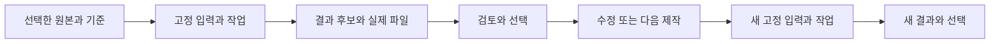

# 여러 생성 도구의 데이터를 연결하는 리니베라 MCP 고도화 방향

2026-10-22. 사용자의 방향 보정을 반영한 설계 제안이다. 설계 정본과 기존 공통 자원 계약을 이어 적용하며 새 기능의 구현 완료를 뜻하지 않는다.

후속 구체화: [Chroma 도구 I/O 조사와 PR별 구현 계획](2026-10-22-chroma-data-implementation-plan.md), [공통 관리 계약](2026-10-22-chroma-data-contracts.md). 37개 파트너의 데이터 유형과 PR #2의 실제 구조를 대조한 계획이다.

**리니베라 MCP의 중심 책임은 여러 도구에서 사용하는 데이터와 생성되는 데이터를 연결·관리하여 다음 작업에 이어 주는 것이다.** 짧은 실험도 입력·후보·선택·수정의 이력을 축적한다. 장편은 이 연결을 여러 장면·회차에 걸쳐 유지하는 활용이다. 매체별 생성이나 Studio 연출 화면은 이 관리 계약을 사용하는 확장으로 다룬다.

## Chroma를 바라보는 기준

도구별로 어떤 입력과 결과가 생기고, 어떤 판본·관계·선택을 남겨야 후속 도구와 다음 회차에서 이어 쓸 수 있는지 조사한다. 크레딧은 서로 다른 도구를 실제로 사용하며 이 공통 계약을 검증하는 자원이다.

공모전 제출작은 관리 흐름을 실제 제작에서 검증하는 사례가 된다. 공급자 수·생성량·작품 길이보다, 도구나 작업 세션이 바뀌어도 선택한 자료와 수정 의도가 이어지는지를 평가한다.

## 기존 언어를 유지하는 관리 단위

현재 `resource-motion` 작업 트리의 `CONTEXT.md`에 있는 Resource, Core source, Representation profile, Input snapshot, Operation, Execution, Derivation, Context package를 재사용한다. 새로운 정본 저장소나 공급자별 별도 기록장을 추가하지 않는다.

| 관리할 데이터 | 보존할 내용 | 다음 작업에서의 용도 |
|---|---|---|
| 원본·기준 | 원고, 인물·세계관, 참고 자료, 스타일·목소리 선택의 정확한 판본과 적용 범위 | 다음 장면·다른 매체의 공통 기준 |
| 작업 의도·실제 입력 | 바꾸려는 것과 유지할 것, 실제 전송 프롬프트·옵션, 입력 판본과 참조 역할 | 수정 의도 복원, 후속 작업의 입력 준비 |
| 실행 관측 | 도구·모델 식별자, 외부 작업 ID, 실제 시도·실패·회수 상태, 확인 가능한 비용 | 중단 후 이어받기, 중복 호출 방지, 비교 |
| 결과 후보 | 이미지·영상·음성·음악·3D·자막·구조화 데이터 등 보존할 중간/최종 결과와 판본 | 후보 비교, 부분 편집, 다른 작업의 입력 |
| 검토·선택 | 정확한 결과에 대한 검토, 채택/미채택, 이유, 다음 입력 선택 | 새 세션에서도 어떤 결과를 사용할지 판단 |
| 사용 맥락 | 어떤 인물·장면·시점·경로를 표현하고, 어디에 어떤 역할·구간으로 쓰였는지 | 장편의 연속성 검토, 영향 범위 확인 |
| 파생 관계 | 실제 입력 판본 → 작업 → 결과 판본, 편집·조립의 연결 | 사용처 조회, 변경 영향, 이전 판본 복원 |

표는 목표 계약이다. 공급자가 반환하지 않는 seed·모델 버전·비용 등을 추정해서 채우지 않는다. 호스트 보고와 도구 응답·로컬 파일에서 확인한 정보를 구별한다. 일회성 내부 버퍼를 전부 자원으로 등록하지 않으며, 선택·비교·수정·재사용에 남긴 후보는 미채택이어도 추적한다.

## 모든 도구를 연결하는 공통 계약

공통으로 필요한 식별·판본·실제 입출력·실행/선택 상태를 정하고, 도구와 매체의 고유 데이터는 판본 있는 확장 데이터로 보존한다. 프롬프트 문자열 하나로 모든 도구의 차이를 덮지 않는다. 원래의 요청·응답도 필요한 범위에서 보존하되 인증 토큰·비밀키는 작업 데이터에 넣지 않는다.

파일·참조·실행 정보는 기존 Resource/Input/Operation과 연결한다. 외부 도구의 URL이나 작업 ID는 결과를 찾는 단서이며, 실제 회수한 파일의 판본·내용 확인을 대체하지 않는다. seed와 입력이 같아도 외부 모델의 재생성 결과가 같다고 보장하지 않는다.

API, 웹 UI, 사용자가 가져온 파일 모두 같은 관리 계약을 사용할 수 있어야 한다. 실행 Adapter가 있는 도구는 등록과 결속을 자동화하고, 다른 경로의 파일도 사용자가 지정한 출처와 관측 범위를 남겨 연결한다. API 자동 생성 지원 여부와 데이터 관리 지원 여부를 따로 표시한다.

MCP 호출자가 알아야 할 Interface는 **필요한 자료 찾기·선택 → 입력 고정 → 작업과 결과 연결 → 검토·선택 → 다음 입력으로 재사용**이라는 공통 흐름이다. 기존 MCP 도구를 재사용하며 매체마다 이 흐름을 새로 배우게 하지 않는다. 외부 실행은 호스트/Adapter가 맡고 core는 모델·네트워크를 호출하지 않는다.

### 연결할 관계의 의미를 구별한다

- 같은 자원의 수정 이력과 다른 자원으로의 파생 관계는 다르다. 캐릭터 설정, 그 캐릭터의 포즈 이미지, 그 포즈로 만든 영상은 각각 식별하며 서로 연결한다.
- 동일한 외형을 사용했다는 사실과 같은 시점·소품 상태·이야기 경로라는 사실은 다르다. 등장/사용 맥락을 기록한다.
- 자료를 후보로 찾은 것, 실제 실행 입력으로 제공한 것, 결과의 근거로 확인한 것은 다르다. 모든 참고 자료를 실제 사용한 것처럼 연결하지 않는다.
- 결과 등록, 품질 검토, 다음 작업 입력 선택, 세계관 정본 채택은 각각의 결정이다. 생성됐다는 이유만으로 기준을 바꾸지 않는다.

## 짧은 실험의 반복과 장편의 연속성

두 경우에 같은 관리 흐름을 적용한다.

작업 흐름은 반복되지만 과거 입력·결과·결정을 덮어쓰지 않는다. 새 작업은 선택한 정확한 판본에서 이어진다. 통신 재시도로 같은 외부 결과를 회수하는 경우와 새 후보를 생성하는 경우도 구별한다. 현재 Operation은 한 번 제출한 결과를 다른 결과로 바꾸지 못하므로, 의도적으로 새 생성을 하면 새 작업으로 남긴다.

짧은 실험에서는 ‘무엇을 유지하고 무엇을 바꿨는가’, ‘어떤 후보를 왜 골랐는가’를 복원할 수 있어야 한다. 다음 실험은 그 선택을 가져오고 변경할 항목만 새로 정한다.

장편에서는 여기에 회차·장면·시점·경로별 사용 맥락이 누적된다. 다음 회차를 만들 때 선택한 인물·스타일·목소리와 관련 사건·현재 상태·미해결 사항을 작업 범위에 맞게 가져온다. 이때 전체 기록을 매번 전달하는 대신 필요한 지식 묶음을 구성하고 근거와 누락 범위를 표시한다.

예를 들어 1화에서 고른 얼굴과 목소리를 8화에 사용하되, 8화에서 젖은 외투를 입는 것은 해당 등장 상태로 관리한다. 8화의 외투 수정이 캐릭터의 공통 기준을 자동 변경하지 않는다. 캐릭터 기준 자체를 바꾸기로 결정했다면 관련 포즈·장면의 재검토 필요와 사용처를 알려준다. 의도적으로 고정한 과거 판본은 그대로 남긴다.

관리 기록은 연속성을 검토·수정하는 근거다. 실제 이미지·음성·내용이 기준과 일치하는지에 대한 검토도 함께 필요하다. hash 일치는 캐릭터의 의미적 일관성을 증명하지 않는다.

## 다음 고도화의 우선순위

| 순서 | 범위 | 확인할 사용자 경험 |
|---|---|---|
| 1 | 생성 입력·실행·후보·선택을 기존 공통 자원과 연결하는 계약 | 다른 도구에서 만든 결과도 출처와 선택 이유를 따라가 다시 사용 |
| 2 | 변경 의도와 유지 기준을 포함한 반복 작업 지원 | 이전 결과를 가져와 특정 항목만 바꾸고 대안과 이전 선택을 보존 |
| 3 | 다음 작업의 지식 묶음 구성·시점/경로별 사용 맥락·변경 영향 | 새 세션·새 회차에서도 적절한 자료와 기준을 찾아 이어 작업 |
| 4 | 위 관리 흐름을 실제 제작으로 검증 | 짧은 작품의 여러 차례 수정과 여러 회차의 연속 제작 모두에서 연결 유지 |

첫 검증은 이미지 제작과 음성/영상 제작처럼 데이터가 실제로 다른 두 경로를 사용한다. 이 두 경로의 차이를 보고 공통 Interface와 Adapter를 구체화한다. Chroma 전체 기업용 커넥터를 한꺼번에 만드는 범위는 잡지 않는다. 지원 데이터 유형은 함께 목록화하고 미연결 유형도 표현·보존할 계약을 검토한다.

완료 사례는 ‘설정에서 후보 이미지 생성 → 하나를 선택 → 다른 도구에서 짧은 영상 제작 → 피드백으로 한 부분 수정 → 이전 선택과 비교 → 새 작업 세션에서 다음 장면 제작’이다. 각 단계의 원본·입력·결과·선택을 왕복 조회하고 필요한 판본을 다시 사용할 수 있어야 한다. 실제 작품·생성 파일은 저장소에 커밋하지 않고 자동 검증은 합성 fixture를 사용한다.

## 현재 구현과의 연결 근거

읽기 전용으로 확인한 `/Users/lyoojk/.codex/worktrees/resource-motion/folio`의 HEAD는 `891568e`다. 공통 Resource·Input snapshot·Operation·판본 그래프와 전이 변경 영향이 이미 기반으로 있다. 현재 계약을 확장하는 제안이며 별도 엔진 신설이나 배포 완료 주장이 아니다.

- [기존 도메인 언어](/Users/lyoojk/.codex/worktrees/resource-motion/folio/CONTEXT.md)
- [공통 자원과 관리 흐름](/Users/lyoojk/.codex/worktrees/resource-motion/folio/docs/resources.md)
- [작업 요청·결과 결속](/Users/lyoojk/.codex/worktrees/resource-motion/folio/core/operations/requests.js)
- [공통 자산·재사용 계약](2026-10-21-creative-resource-lineage.md)

기존 hash·영수증·hard 차단·추가 전용 기록장·자기검토 표기·soft 비자동수정은 이 확장에서도 유지한다. 이번 변경은 방향과 관리 계약의 제안이며 제품 코드나 사용자 작품은 변경하지 않았다.
